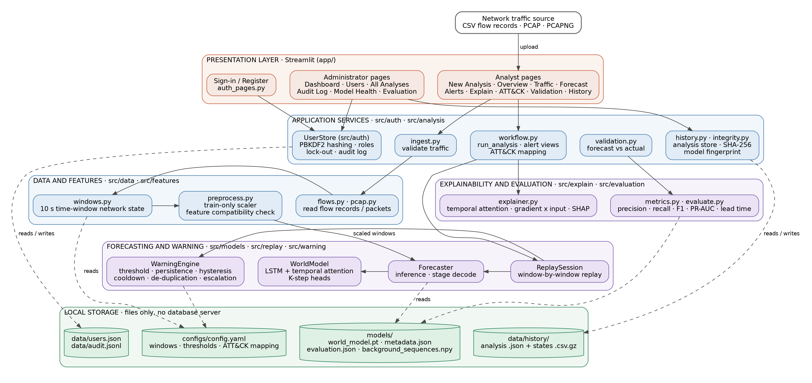
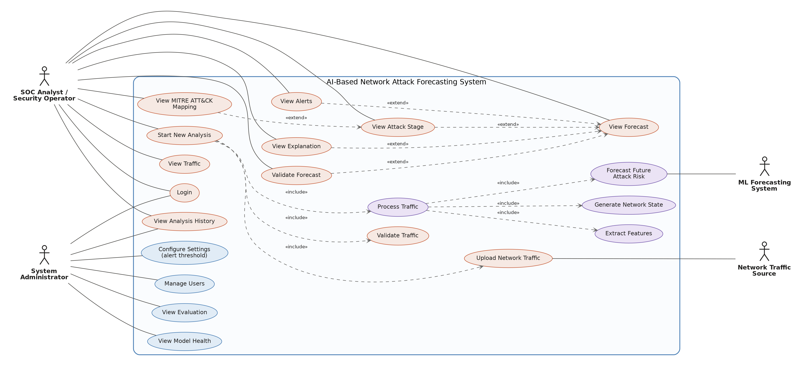
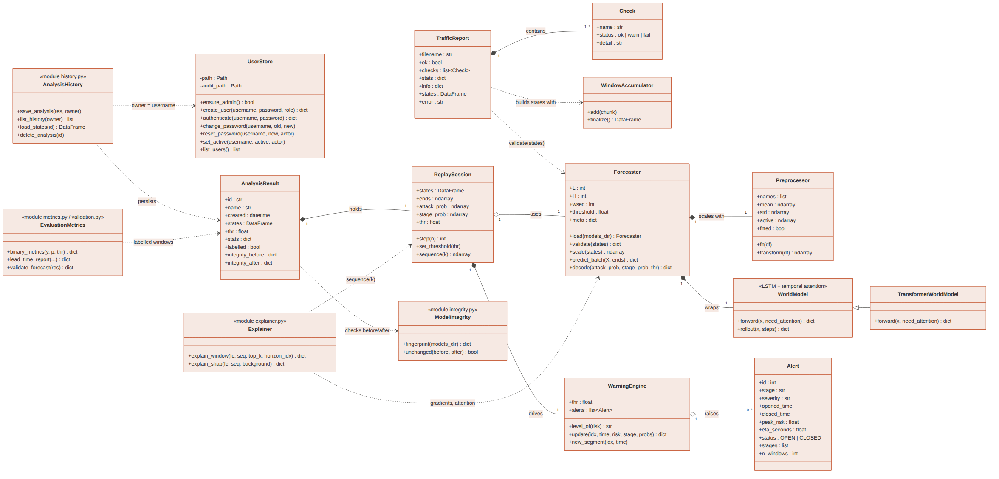
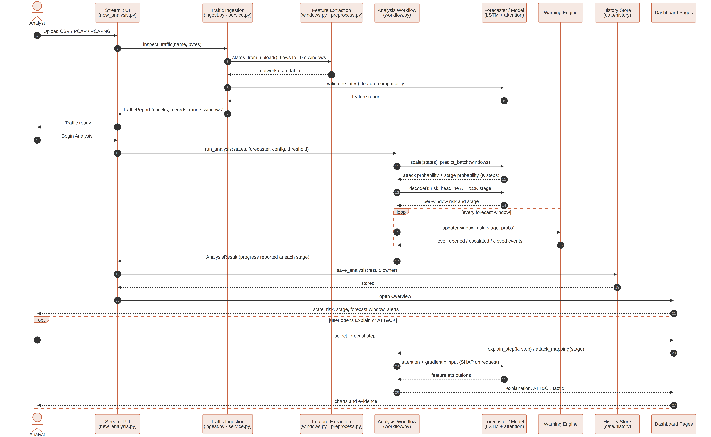
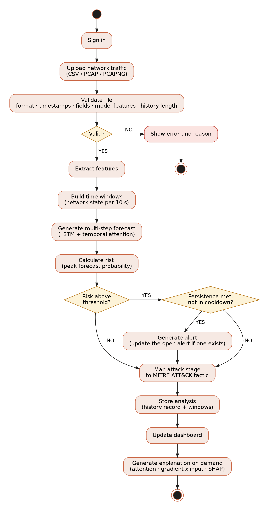
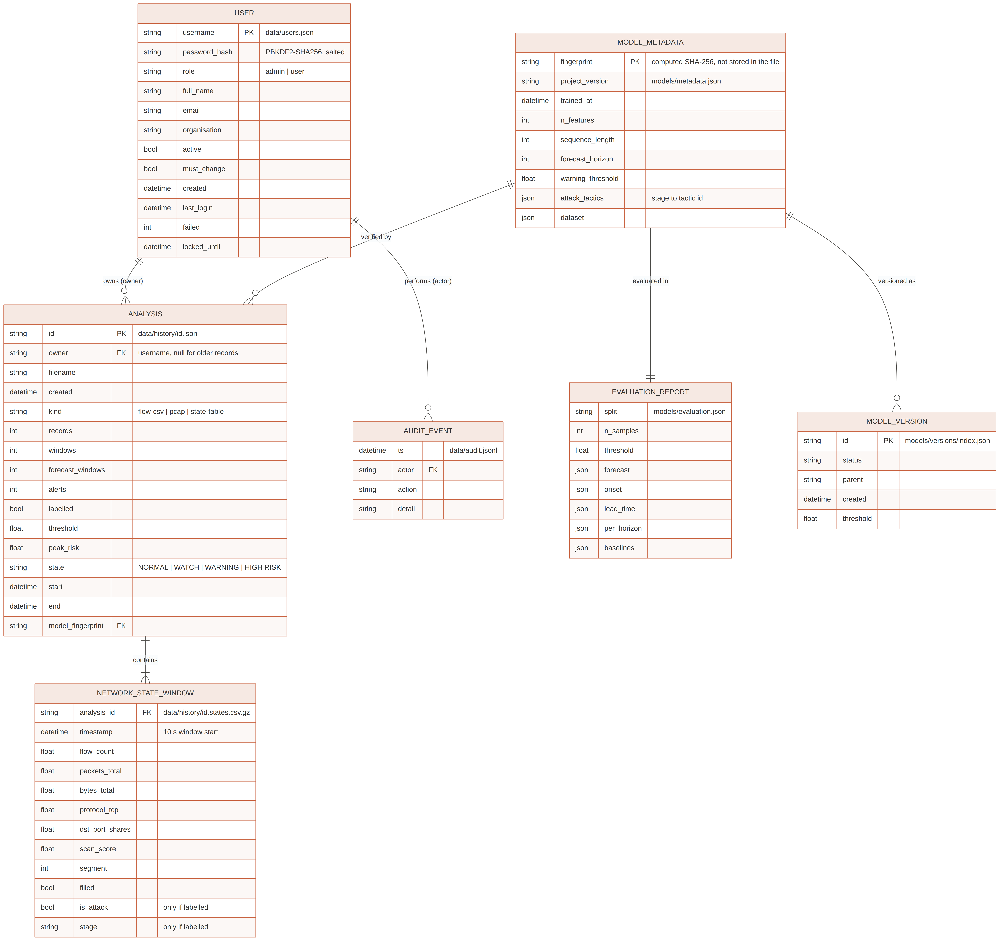
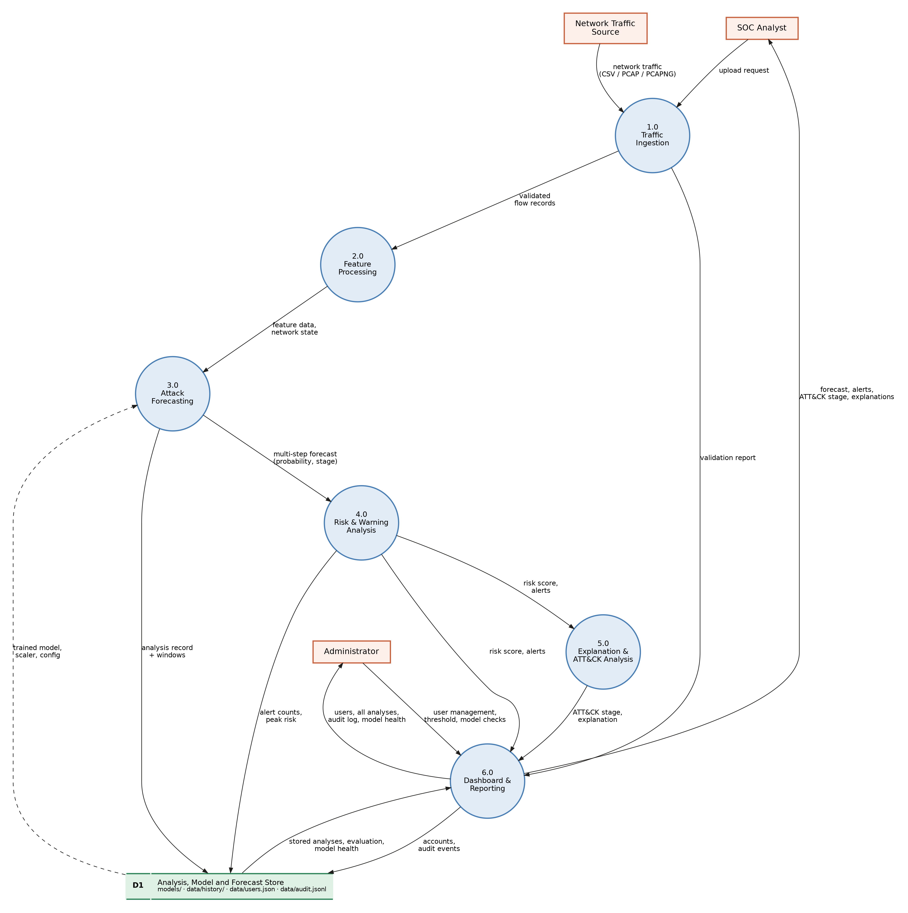

# AI-Based Network Attack Forecasting from Network Traffic Data - Design Diagrams

## 1. System Architecture

Traffic (CSV, PCAP or PCAPNG) is validated, converted into 10-second time-window network states, scaled with a scaler fitted on training data only, and passed to an LSTM with temporal attention that forecasts attack probability and attack stage for the next six windows. The warning engine turns forecasts into alerts (persistence, hysteresis, cooldown, de-duplication, escalation). The stage is mapped to a MITRE ATT&CK tactic and each prediction can be explained. Access is role-based; everything is stored in local files.

## 2. Use Case Diagram

The analyst starts analyses and reviews their results. The administrator manages users, reviews all analyses, checks model health and evaluation, and configures the alert threshold. *Start New Analysis* includes upload, validation and processing; processing includes feature extraction, network-state generation and forecasting.

## 3. Class Diagram

## 4. Sequence Diagram

## 5. Activity Diagram

## 6. ER Diagram (logical data model)

The application stores data in JSON / CSV files rather than a database server, so this is the logical model of those files. Forecasts, alerts and explanations are recomputed from the stored windows and are not stored as tables.

## 7. Level-1 Data Flow Diagram

See `diagrams/README.md` for the mapping of each diagram to the code and for accuracy notes.
